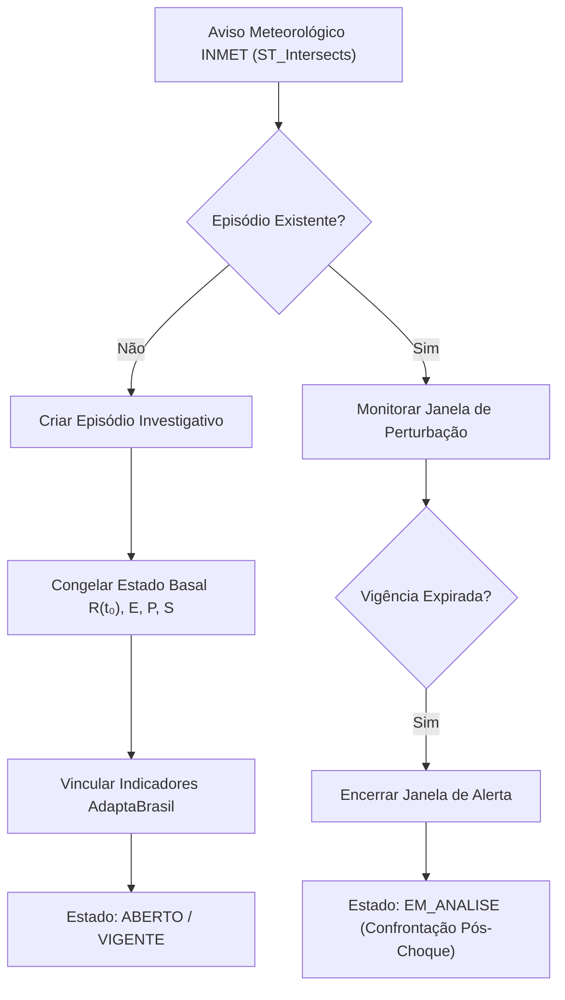

# MÉTIS — Diretriz de Integração de Evidências Climáticas, Perturbações Operacionais e Investigação da Resiliência
**Documento:** METIS-DIR-EVID-001  
**Versão:** 0.1.0  
**Data:** 29/10/2026  
**Natureza:** Diretriz metodológica, arquitetural e epistemológica para ingestão contínua de evidências empíricas e deflagração de episódios investigativos  
**Status:** Homologado e Vigente  

---

## 1. Princípio Epistêmico e Separação Metodológica

O MÉTIS estabelece uma separação metodológica estrita entre:

1. **O Modelo Matemático Territorial ($R$):** Calcula a capacidade de sustentação intrínseca do território a partir de sua estrutura ecológica ($E$), densidade produtiva ($P$) e coesão sociotécnica ($S$) com base em dados censitários homologados e imutáveis.
2. **A Camada de Confrontação Empírica:** Ingestão contínua de vulnerabilidades climáticas e perturbações do mundo físico para realizar **testes de estresse** sobre as hipóteses teóricas de resiliência.

> [!IMPORTANT]
> **Isolamento da Equação de Resiliência:**  
> Indicadores climáticos e alertas meteorológicos **não entram como variáveis aditivas ou multiplicativas na fórmula matemática de $R$**. O MÉTIS não realiza deduções ingênuas (como subtrair pontos de resiliência ao chover ou adicionar pontos na ausência de alertas).  
> A função das evidências externas é atuar como um **confrontador epistêmico**: quando uma perturbação real incide sobre um município, o sistema congela o estado basal $R(t_0)$ e abre um **Episódio de Investigação Científica** para averiguar se territórios com alto $R$ de fato preservam suas funções ecológicas e socioeconômicas.

---

## 2. Fontes Oficiais Integradas

| Fonte | Interface Técnica | Natureza dos Dados | Papel no MÉTIS |
| :--- | :--- | :--- | :--- |
| **AdaptaBrasil MCTI** | API REST JSON oficial (`/api/hierarquia`, `/api/mapa-dados`) | 558 indicadores catalogados; índices de risco, exposição, suscetibilidade, vulnerabilidade e capacidade adaptativa; cenários futuros IPCC (2030, 2050 sob RCP4.5) | Caracterização estrutural da vulnerabilidade climática crônica na segurança alimentar |
| **INMET Operacional** | API REST JSON / WIS2 CAP (`/avisos/ativos`, `/avisos/rss`) | Avisos meteorológicos severos em tempo real com polígonos geoespaciais e severidade declarada | Deflagração de perturbações agudas e abertura de episódios investigativos |

---

## 3. Modelo de Dados Espacial (PostGIS)

A integração apoia-se em quatro tabelas e views estruturadas no PostgreSQL 17 / PostGIS 3.5:

### 3.1. `catalogo_indicadores_adaptabrasil`
Armazena a hierarquia oficial completa de 558 indicadores do MCTI, incluindo nomes técnicos, descrições, fórmulas de cálculo e unidade de medida.

### 3.2. `evidencias_adaptabrasil`
Persiste os valores municipais dos indicadores essenciais de segurança alimentar para os 497 municípios do Rio Grande do Sul:
- **5001:** Índice de Risco na Disponibilidade de Alimentos (Baseline 2017, Projeções 2030 e 2050 sob RCP4.5)
- **5002:** Exposição na Disponibilidade de Alimentos
- **5003:** Vulnerabilidade na Disponibilidade de Alimentos
- **60041:** Capacidade Adaptativa da População Rural

### 3.3. `avisos_meteorologicos_inmet`
Armazena o registro completo de alertas meteorológicos, suas janelas de vigência (`inicio`, `fim`), severidade, descrição de riscos e o polígono geoespacial (`geometry(Geometry, 4326)`).

### 3.4. `vw_municipios_avisos_inmet`
View geoespacial reativa que efetua o cruzamento topológico via `ST_Intersects`:
```sql
ST_Intersects(m.geometria, a.geometria)
```
Classificando dinamicamente o `estado_vigencia`:
- `vigente`: Horário atual contido entre `inicio` e `fim`, com `encerrado = FALSE`.
- `futuro`: Horário atual anterior a `inicio`.
- `expirado`: Horário atual posterior a `fim`.
- `cancelado`: Marcado com `encerrado = TRUE` antes do término formal.

---

## 4. O Motor de Episódios Investigativos

Para transformar um alerta meteorológico em investigação científica sistemática, o motor (`scripts/motor_episodios.py`) opera segundo o seguinte protocolo:



### 4.1. Estrutura do Registro (`episodios_investigacao`)
- `id`: Código rastreável do episódio (ex: `EP-4302105-20261029-001`).
- `municipio_id`: Município IBGE sob investigação.
- `aviso_id`: Alerta do INMET correspondente.
- `estado_episodio`: Ciclo de vida (`aberto`, `em_analise`, `corroborado`, `refutado`, `arquivado`).
- `estado_metis_congelado`: JSON imutável com $R(t_0)$, $E$, $P$, $S$, modelo ativo e calibração de parâmetros prévia ao choque.
- `evidencias_antecedentes`: JSON imutável com os indicadores do AdaptaBrasil no momento da abertura.
- `desfecho_cientifico`: Parecer metodológico confrontando o desempenho territorial com a previsão do modelo.

---

## 5. Salvaguardas Éticas e Tratamento de Falsos Negativos

1. **Ausência de Alerta ≠ Ausência de Risco:**  
   O sistema declara explicitamente que a ausência de avisos ativos do INMET não comprova inexistência de perturbação no território. A interface nunca rotula um município calmo como "seguro" de forma leviana, mas sim como *"Sem alertas meteorológicos vigentes emitidos pelo INMET"*.
2. **Sanitização de Entradas Externas:**  
   Todo texto proveniente de APIs governamentais externas passa por filtros estritos de escape HTML (`escapeHtml`), prevenindo injeções de script ou inconsistências de formatação.
3. **Imutabilidade e Reprodutibilidade:**  
   A sincronização é auditável via script CLI `./run.sh sync` e exposta em endpoints de leitura pública (`api/public/evidencias_rs.json` e `api/public/episodios_rs.json`).
